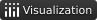
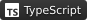
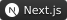

<div align="center">
<div>
<a href="https://t.me/first_millennium" style="text-decoration: none;font-size: 0; line-height: 0;display: inline-block; overflow: hidden;"></a><a href="https://github.com/denis-ermolaev" style="text-decoration: none;font-size: 0; line-height: 0;display: inline-block; overflow: hidden;"></a>
</div>

<div>
<a href="mailto:denis-ermolaev@internet.ru" style="text-decoration: none;font-size: 0; line-height: 0;display: inline-block; overflow: hidden;"></a><a href="https://rxresu.me/denis-ermolaev/resume-python-developer" style="text-decoration: none;font-size: 0; line-height: 0;display: inline-block; overflow: hidden;"></a>
</div>

</div>

### Core Stack

<div style="padding-bottom: 6px;">
    <span style="line-height: 1;"><b>Backend:</b></span>
    
    
    
    
    
</div>

<div style="padding-bottom: 6px;">
    <span style="line-height: 1;"><b>Data Science:</b></span>
    
    
    
    
</div>

<div style="padding-bottom: 6px;">
    <span style="line-height: 1;"><b>Tools:</b></span>
    
    
    
    
    
    
    
    
</div>

<div style="padding-bottom: 6px;">
    <span style="line-height: 1;"><b>Frontend:</b></span>
    
    
    
    
    
    
</div>

<br>

<!--START_SECTION:waka-->
📊 **This Week I Spent My Time On** 

```text
💬 Programming Languages: 
Markdown                 5 hrs 58 mins       ██████████░░░░░░░░░░░░░░░   41.19 % 
Python                   4 hrs 27 mins       ████████░░░░░░░░░░░░░░░░░   30.70 % 
YAML                     1 hr 7 mins         ██░░░░░░░░░░░░░░░░░░░░░░░   07.70 % 
Makefile                 1 hr 4 mins         ██░░░░░░░░░░░░░░░░░░░░░░░   07.36 % 
Other                    49 mins             █░░░░░░░░░░░░░░░░░░░░░░░░   05.65 % 

🐱‍💻 Projects: 
django-procurement-api   12 hrs 23 mins      █████████████████████░░░░   85.34 % 
wiki                     46 mins             █░░░░░░░░░░░░░░░░░░░░░░░░   05.34 % 
GTD                      37 mins             █░░░░░░░░░░░░░░░░░░░░░░░░   04.26 % 
final_qualification_work 23 mins             █░░░░░░░░░░░░░░░░░░░░░░░░   02.69 % 
first                    10 mins             ░░░░░░░░░░░░░░░░░░░░░░░░░   01.19 % 
```
<!--END_SECTION:waka-->
